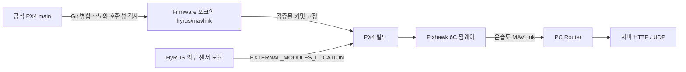

# HyRUS EnvData PX4

SHTC3 I2C 온습도 센서를 읽는 **PX4 공식 외부 모듈(Out-of-Tree)** 저장소입니다. 센서·진단 모듈은 여기에서 관리하고, MAVLink 송신에 필요한 PX4 본체 수정은 [VIPSfef/Firmware의 `hyrus/mavlink` 브랜치](https://github.com/VIPSfef/Firmware/tree/hyrus/mavlink)에서 관리합니다. 빌드할 때 패치를 적용하지 않고, 수정이 커밋된 포크를 가져와 외부 모듈과 함께 컴파일합니다.

결과물은 센서 모듈을 포함한 하나의 Pixhawk 6C 펌웨어입니다. PC에서 MAVLink를 해석하고 HTTP·UDP로 서버에 전달하는 기능은 별도 [HyRUS_EnvData_Router](https://github.com/VIPSfef/HyRUS_EnvData_Router)가 담당합니다.



## 저장소와 소스 구성

| 위치 | 역할 |
| --- | --- |
| 이 저장소의 `src/CMakeLists.txt` | 공식 외부 모듈 목록과 빌드 연결 |
| `src/drivers/hygrometer/shtc3/` | 센서 측정·오류 복구·uORB 발행 |
| `src/systemcmds/shtc3_probe/` | I2C 제품 ID·CRC 진단 |
| `test/hyrus/` | 센서·포크 스트림·실제 생성 MAVLink 패킷 검사 |
| `sdcard/etc/extras.txt` | SD 카드 부팅 스크립트에 합칠 센서 시작 예제 |
| `Tools/hyrus/project.json` | 공식 기준 커밋·포크 커밋·보드·추적 브랜치 |
| 포크의 `src/modules/mavlink/` | MAVLink 스트림·메시지 정의·등록·기본 송신 설정 |

`Firmware/master`는 공식 코드 동기화용이며, 실제 빌드는 `hyrus/mavlink`의 고정 커밋을 사용합니다. `project.json`의 `upstream_commit`은 공식 PX4 기준, `px4_commit`은 MAVLink 수정이 포함된 포크 커밋입니다. 준비 스크립트는 브랜치의 최신 끝을 임의로 사용하지 않습니다. 보드 타깃은 `px4_fmu-v6c_default`입니다.

기존 오버레이 방식은 `archive/overlay-v1.16`, PX4 전체 소스를 포함했던 작업본은 로컬 `archive/in-tree-v1.16`에 보존합니다. 현재 외부 모듈 저장소에는 PX4 전체 소스나 빌드 시 적용할 패치 파일을 넣지 않습니다.

## 준비와 검증

Ubuntu 또는 WSL2 Ubuntu의 **Linux 파일시스템**에서 실행합니다. 아래 명령의 시작 위치는 이 저장소 루트입니다. 이전 패치 방식의 PX4 작업본과 섞이지 않도록 새 전용 경로를 사용합니다.

```sh
HYRUS_PX4_DIR="$HOME/src/PX4-HyRUS-Fork"
python3 Tools/hyrus/firmware.py prepare --px4-dir "$HYRUS_PX4_DIR"
PIP_CONSTRAINT="$PWD/Tools/hyrus/python-constraints.txt" \
  bash "$HYRUS_PX4_DIR/Tools/setup/ubuntu.sh" --no-sim-tools
python3 Tools/hyrus/validate.py --px4-dir "$HYRUS_PX4_DIR" --jobs 6
```

준비 도구는 포크의 지정 커밋과 그 커밋에 기록된 하위 모듈을 준비하고, 공식 기준과의 차이가 허용한 MAVLink 경로에만 있는지 검사합니다. 기존 작업본에 수정 사항이 있으면 보존하고 중단합니다. `--px4-dir`을 생략하면 이 저장소의 Git에서 제외된 `build/px4/`를 사용합니다.

공식 `ubuntu.sh`는 개발 의존성을 설치하며 `sudo`가 필요할 수 있습니다. 검증 도구는 커밋된 깨끗한 외부 모듈 작업본에서 실행합니다. native 테스트, 실제 보드 펌웨어 빌드, 생성된 MAVLink 헤더를 사용하는 패킷 검사와 최종 명령·파라미터 포함 검사를 수행합니다. 센서 소스를 PX4 안으로 복사하거나 기체에 펌웨어를 설치하지 않습니다.

준비된 소스에서 펌웨어만 직접 빌드할 때는 공식 외부 모듈 옵션을 사용합니다.

```sh
make -C "$HYRUS_PX4_DIR" px4_fmu-v6c_default \
  "EXTERNAL_MODULES_LOCATION=\"$PWD\""
```

원본 출력은 `$HYRUS_PX4_DIR/build/px4_fmu-v6c_default/px4_fmu-v6c_default.px4`입니다. 검증 도구는 펌웨어, `validation.json`, 단계별 로그를 이 저장소의 `build/hyrus-ci/`에 모읍니다. 외부 모듈 경로는 CMake 설정에 남으므로 저장소를 옮겼다면 경로를 다시 설정해야 합니다.

## 센서 시작

자동 시작 예제는 외부 I2C **버스 2**, 주소 **`0x70`**의 SHTC3 한 개를 대상으로 합니다. 실제 보드·배선에 맞춰 버스 번호를 확인하세요. `SENS_EN_SHTC3` 기본값은 `0`이며, 예제는 이 값이 `1`일 때만 드라이버를 시작합니다.

`sdcard/etc/extras.txt`의 내용을 SD 카드의 `/fs/microsd/etc/extras.txt`에 **기존 내용과 합쳐서** 넣습니다. 이미 있는 부팅 명령을 파일 복사로 덮어쓰지 마세요. 이 방식은 PX4의 `rc.sensors`를 수정하지 않습니다. 펌웨어 설치, SD 카드 편집, 파라미터 변경은 별도의 장치 적용 절차입니다.

## 업데이트와 문서

`hyrus-upstream.yml`은 공식 `main`의 새 커밋을 임시 포크 작업본에 Git으로 병합한 후보를 검사합니다. 병합·테스트·펌웨어 빌드가 실패하면 기존 포크와 빌드 기준을 유지합니다. 성공하면 포크 후보와 외부 모듈의 버전 지정 후보를 각각 Git bundle로 보관합니다. 이 검사는 읽기 권한으로 실행되며 원격 브랜치 변경·PR 생성·자동 병합·기체 설치는 하지 않습니다. 검토 후 포크 커밋을 먼저 게시하고 외부 모듈의 버전 지정을 반영합니다.

- [전체 빌드·데이터·실패 흐름](docs/architecture.md)
- [기존 Firmware 포크의 갱신과 브랜치 역할](docs/fork-comparison.md)
- [자동 검사와 업데이트 운영 절차](Tools/hyrus/CI.md)
- [변경 검증 workflow](.github/workflows/hyrus-ci.yml), [main 추적 workflow](.github/workflows/hyrus-upstream.yml)
- [PX4 공식 외부 모듈 지침](https://docs.px4.io/main/en/advanced/out_of_tree_modules)
- [PX4 공식 MAVLink 스트림 지침](https://docs.px4.io/main/en/mavlink/streaming_messages)

검증 결과는 기록된 외부 모듈 커밋과 포크 커밋의 조합에만 해당합니다. 이전 v1.16 빌드 성공을 최신 main의 검증 결과로 간주하지 마세요. 전체 빌드 성공도 실제 I2C 동작·기체 운용 시험을 대신하지 않습니다.
