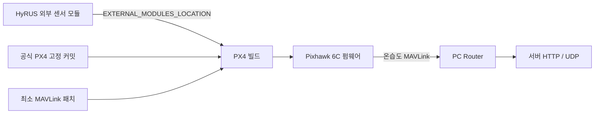

# HyRUS EnvData PX4

SHTC3 I2C 온습도 센서를 읽고 MAVLink로 전달하는 **PX4 공식 외부 모듈(Out-of-Tree)** 저장소입니다. 센서 소스는 이 저장소에서 관리하고, `EXTERNAL_MODULES_LOCATION`으로 PX4 빌드에 연결합니다. 결과물은 센서 모듈을 포함한 하나의 PX4 펌웨어입니다.

PC에서 MAVLink를 해석하고 HTTP·UDP로 서버에 전달하는 기능은 별도 [HyRUS_EnvData_Router](https://github.com/VIPSfef/HyRUS_EnvData_Router)가 담당합니다.



## 소스 구성

| 경로 | 역할 |
| --- | --- |
| `src/CMakeLists.txt` | 공식 외부 모듈 목록과 빌드 연결 |
| `src/drivers/hygrometer/shtc3/` | 센서 측정·오류 복구·uORB 발행 |
| `src/systemcmds/shtc3_probe/` | I2C 제품 ID·CRC 진단 |
| `mavlink/` | 온습도 스트림과 메시지 정의 연결 |
| `patches/px4-mavlink.patch` | PX4 본체의 MAVLink 파일 4개에만 적용하는 변경 |
| `sdcard/etc/extras.txt` | SD 카드 부팅 스크립트에 합칠 센서 시작 예제 |
| `Tools/hyrus/project.json` | 검증 기준 PX4 커밋·보드·추적 브랜치 |

기준 PX4는 v1.16.0의 `6ea3539157ca358c70a515878b77077af7d4611d`, 보드는 Pixhawk 6C의 `px4_fmu-v6c_default`입니다. 공식 개발 브랜치 `main`도 별도 후보로 검사합니다. 이전 오버레이 방식은 `archive/overlay-v1.16`에 보존합니다. PX4 전체 소스를 포함했던 작업본은 로컬 `archive/in-tree-v1.16` 브랜치에 보존하며 외부 모듈 저장소에는 게시하지 않습니다.

## 준비와 검증

Ubuntu 또는 WSL2 Ubuntu의 **Linux 파일시스템**에서 실행합니다. 아래 명령의 시작 위치는 이 저장소 루트입니다. PX4 작업 경로는 전용 디렉터리로 지정하세요.

```sh
HYRUS_PX4_DIR="$HOME/src/PX4-HyRUS"
python3 Tools/hyrus/firmware.py prepare --px4-dir "$HYRUS_PX4_DIR"
bash "$HYRUS_PX4_DIR/Tools/setup/ubuntu.sh" --no-sim-tools
python3 Tools/hyrus/validate.py --px4-dir "$HYRUS_PX4_DIR" --jobs 6
```

준비 도구는 설정에 고정된 공식 PX4와 하위 모듈을 준비하고 MAVLink 패치를 적용합니다. 검증 도구는 native 테스트, 실제 보드 펌웨어 빌드, 생성된 MAVLink 헤더를 사용하는 패킷 검사를 실행합니다. 명령 자체는 기체에 펌웨어를 설치하지 않습니다.

준비된 PX4에서 펌웨어만 직접 빌드할 때는 공식 외부 모듈 옵션을 사용합니다.

```sh
make -C "$HYRUS_PX4_DIR" px4_fmu-v6c_default \
  "EXTERNAL_MODULES_LOCATION=\"$PWD\""
```

출력 파일은 `$HYRUS_PX4_DIR/build/px4_fmu-v6c_default/px4_fmu-v6c_default.px4`입니다. 외부 모듈 경로는 CMake 설정에 남으므로 저장소를 옮겼다면 경로를 다시 설정해야 합니다.

## 센서 시작

자동 시작 예제는 외부 I2C **버스 2**, 주소 **`0x70`**의 SHTC3 한 개를 대상으로 합니다. 실제 보드·배선에 맞춰 버스 번호를 확인하세요. `SENS_EN_SHTC3` 기본값은 `0`이며, 예제는 이 값이 `1`일 때만 드라이버를 시작합니다.

`sdcard/etc/extras.txt`의 내용을 SD 카드의 `/fs/microsd/etc/extras.txt`에 **기존 내용과 합쳐서** 넣습니다. 이미 있는 부팅 명령을 파일 복사로 덮어쓰지 마세요. 이 방식은 PX4의 `rc.sensors`를 수정하지 않습니다. 펌웨어 설치, SD 카드 편집, 파라미터 변경은 별도의 장치 적용 절차입니다.

## 업데이트와 문서

`hyrus-upstream.yml`은 공식 `main`의 새 커밋을 후보로 검사합니다. 패치 적용, 테스트 또는 펌웨어 빌드가 실패하면 검증 기준을 유지합니다. 통과한 경우에만 `project.json`의 PX4 커밋을 갱신하는 PR을 제안합니다. 자동 병합·기체 설치는 수행하지 않습니다.

- [전체 빌드·데이터·실패 흐름](docs/architecture.md)
- [기존 Firmware 포크와 공식 PX4 비교](docs/fork-comparison.md)
- [자동 검사와 업데이트 운영 절차](Tools/hyrus/CI.md)
- [변경 검증 workflow](.github/workflows/hyrus-ci.yml), [main 추적 workflow](.github/workflows/hyrus-upstream.yml)
- [PX4 공식 외부 모듈 지침](https://docs.px4.io/main/en/advanced/out_of_tree_modules)
- [PX4 공식 MAVLink 스트림 지침](https://docs.px4.io/main/en/mavlink/streaming_messages)

이 문서는 사용 절차를 설명합니다. 이전 내장 방식의 빌드 성공을 현재 외부 모듈 방식의 검증 결과로 간주하지 마세요. 실제 통과 여부는 해당 커밋의 검증 보고서와 CI 기록으로 확인합니다. 전체 빌드 성공도 실제 I2C 동작·기체 운용 시험을 대신하지 않습니다.
