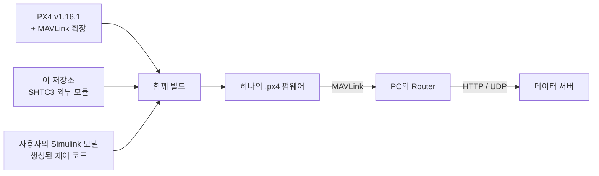

# HyRUS EnvData PX4

**Simulink R2026b / PX4 v1.16.1에서 SHTC3 온습도 센서를 읽고 MAVLink로 보내기 위한 프로젝트**입니다. 센서 코드는 이 저장소의 외부 모듈로 관리하고, MAVLink 연결 코드는 [PX4 포크의 `hyrus/r2026b`](https://github.com/VIPSfef/Firmware/tree/hyrus/r2026b)에 유지합니다.

Simulink 제어 코드는 같은 PX4에 별도 모듈로 들어갑니다. 이들을 함께 컴파일하면 기체에 올릴 **하나의 `.px4` 펌웨어**가 됩니다. PC에서 MAVLink를 해석해 서버로 전달하는 프로그램은 [HyRUS EnvData Router](https://github.com/VIPSfef/HyRUS_EnvData_Router)입니다.



> **처음 사용하는 PC라면 [R2026b 설치·빌드·Simulink 연결 안내](docs/simulink-r2026b.md)부터 읽으세요.** 아래 명령은 개발 환경이 준비된 Ubuntu/WSL 터미널에서 실행하는 빠른 빌드 경로입니다. 실제 Simulink 모델의 코드 생성·기체 부팅·비행 시험은 별도 확인 대상입니다.

## 어떤 저장소와 브랜치를 쓰나요?

| 대상 | 역할 | 이 작업에서 사용할 것 |
| --- | --- | --- |
| `HyRUS_EnvData_Px4` | 센서 드라이버·진단·빌드 도구·문서 | `main` |
| `Firmware` | PX4 본체와 MAVLink 확장 | `hyrus/r2026b` — 공식 v1.16.1 기반 |
| 사용자의 모델 저장소 | `.slx`, 데이터 사전, 사용자 제어 코드 | 사용자가 별도 관리 |
| `HyRUS_EnvData_Router` | MAVLink 수신, HTTP·UDP 서버 전송 | PC에서 별도로 실행 |

`Firmware/hyrus/mavlink`는 최신 공식 `main`을 추적하는 개발 브랜치입니다. R2026b 작업은 `hyrus/r2026b`를 사용합니다. MATLAB 릴리스마다 지원 PX4 버전이 다르기 때문입니다. [MathWorks R2026b의 PX4 버전 지침](https://www.mathworks.com/help/uav/px4/ug/downloading-px4-source-code-wsl2.html)

## 빠른 빌드

WSL에서는 `/mnt/c` 아래 대신 **Linux 홈 폴더**에 받습니다. 아래 명령은 두 폴더가 아직 없는 새 작업 위치를 기준으로 합니다.

```sh
mkdir -p "$HOME/src"
cd "$HOME/src"

git clone https://github.com/VIPSfef/HyRUS_EnvData_Px4.git
git clone --filter=blob:none --single-branch --branch hyrus/r2026b \
  https://github.com/VIPSfef/Firmware.git PX4-HyRUS-R2026b

HYRUS_PX4_DIR="$HOME/src/PX4-HyRUS-R2026b"

# PX4가 빌드 시 사용할 공식 버전 태그와 하위 모듈을 준비합니다.
git -C "$HYRUS_PX4_DIR" fetch --no-recurse-submodules --filter=blob:none --tags \
  https://github.com/PX4/PX4-Autopilot.git refs/tags/v1.16.1
git -C "$HYRUS_PX4_DIR" submodule update --init --recursive

cd "$HOME/src/HyRUS_EnvData_Px4"
# PX4 v1.16.1의 기존 코드 생성기와 호환되는 Python 패키지입니다.
PIP_BREAK_SYSTEM_PACKAGES=1 python3 -m pip install \
  -r Tools/hyrus/profiles/r2026b-python.txt
bash Tools/hyrus/build.sh \
  --px4-dir "$HYRUS_PX4_DIR" \
  --target px4_fmu-v6c_default \
  --jobs 6
```

결과 파일:

```text
~/src/PX4-HyRUS-R2026b/build/px4_fmu-v6c_default/px4_fmu-v6c_default.px4
```

이 명령은 현재 PX4 소스와 센서 외부 모듈을 빌드합니다. Simulink 모델을 자동으로 생성하거나 기체에 업로드하지는 않습니다. 모델을 함께 넣는 순서는 [Simulink 연결 안내](docs/simulink-r2026b.md)에 있습니다.

### 빌드 스크립트 옵션

`build.sh`는 **도구·하위 모듈 확인 → 기존 캐시 확인 → CMake 설정 → 컴파일·링크 → 결과 경로 출력** 순서로 동작합니다. Git 브랜치·커밋이나 사용자 소스를 바꾸지 않습니다.

| 옵션 | 의미 |
| --- | --- |
| `--px4-dir PATH` | 빌드할 PX4 작업본. 생략하면 이 저장소의 `build/px4` |
| `--target BOARD` | 보드 구성. 기본값 `px4_fmu-v6c_default` |
| `--build-dir PATH` | 출력 폴더. 기본값 `PX4경로/build/보드구성` |
| `--jobs N` | 병렬 작업 수. 생략하면 사용 가능한 CPU 수 |
| `--configure-only` | CMake 설정까지만 실행 |
| `--simulink` | HyRUS 연결을 복원하고 실제 빌드에서 Simulink·센서·MAVLink의 최종 링크 확인 |
| `-- -DNAME=VALUE` | 추가 CMake 옵션 |
| `--help` | 전체 사용법 |

예를 들어 `-- -DHYRUS_MAVLINK=OFF`를 전달하면 센서 모듈만 빌드합니다. CMake 옵션은 출력 폴더에 저장되므로 다시 켤 때는 `-- -DHYRUS_MAVLINK=ON`을 명시합니다. 다른 소스·보드·외부 모듈로 만든 캐시를 지정하면 새 `--build-dir`를 선택하도록 안내합니다.

### CMake를 직접 사용할 때

```sh
HYRUS_PX4_DIR="$HOME/src/PX4-HyRUS-R2026b"
HYRUS_MODULE_DIR="$HOME/src/HyRUS_EnvData_Px4"

cmake -S "$HYRUS_PX4_DIR" \
  -B "$HYRUS_PX4_DIR/build/px4_fmu-v6c_default" \
  -G Ninja \
  -DCONFIG=px4_fmu-v6c_default \
  -DCMAKE_BUILD_TYPE=MinSizeRel \
  -DEXTERNAL_MODULES_LOCATION="$HYRUS_MODULE_DIR" \
  -DHYRUS_MAVLINK=ON
cmake --build "$HYRUS_PX4_DIR/build/px4_fmu-v6c_default" --parallel 6
```

별도의 `cmake --install`은 없습니다. Python은 PX4의 MAVLink·uORB·파라미터 생성과 펌웨어 포장에 필요한 **PC 빌드 도구**입니다. 기체에서는 컴파일된 C/C++ 코드가 실행됩니다. 우리 Python 준비·검증 도구는 일반 빌드의 필수 진입점이 아닙니다.

## 기존 PX4에 무엇을 추가하나요?

- SHTC3 드라이버와 진단 명령은 PX4 소스 트리 밖에서 관리합니다.
- MAVLink는 기존 메시지 구성과 기본 스트림을 유지하면서 `SENS_ATMOS`를 추가합니다.
- `HYGROMETER_SENSOR`의 습도 단위를 맞추는 수정은 별도 커밋으로 관리합니다.
- 비행 제어·보드 설정·PX4 기본 부팅 코드는 HyRUS의 MAVLink 이식 대상이 아닙니다.

R2026b용 포크에는 v1.16.1에 맞춘 추가분이 이미 들어 있습니다. 추가분만 필요하면 `hyrus-mavlink-addon-px4-v1.16.1` 태그를 사용합니다. 다른 PX4 버전으로 옮기는 기준과 원래 main용 `hyrus-mavlink-addon-v1` 태그의 용도는 [포크·브랜치 안내](docs/fork-comparison.md)를 보세요. 모든 버전에 무수정으로 적용된다는 의미는 아닙니다.

## 검증과 업데이트

두 경로를 구분합니다.

| 목적 | 경로 |
| --- | --- |
| 사용자 또는 Simulink가 수정한 작업본을 그대로 빌드 | `build.sh --px4-dir ...` |
| 기록된 R2026b 조합을 새 전용 폴더에서 재현·검증 | `firmware.py prepare --profile r2026b`와 `validate.py --profile r2026b` |
| 공식 `main` 변경의 호환성을 미리 확인 | 기존 `main` 프로필과 매일 실행되는 upstream 검사 |

고정 조합 검증 도구는 프로필에 기록된 PX4 커밋을 선택합니다. **Simulink 생성 코드나 사용자 변경이 있는 작업본에는 실행하지 마세요.** 별도의 깨끗한 폴더에서 사용합니다. 명령과 검사 범위는 [CI 운영 안내](Tools/hyrus/CI.md)에 있습니다.

R2026b 기준은 [`Tools/hyrus/profiles/r2026b.json`](Tools/hyrus/profiles/r2026b.json), 최신 main 기준은 [`Tools/hyrus/project.json`](Tools/hyrus/project.json)에 기록합니다. 공식 main의 검사 성공이 R2026b용 기준을 자동으로 올리지는 않습니다.

## 다음에 읽을 문서

| 문서 | 설명 |
| --- | --- |
| [R2026b 설치·빌드·Simulink 연결](docs/simulink-r2026b.md) | 다른 PC에서 처음 시작하는 순서, 모델 연결, 부팅·통신 설정 |
| [구조와 데이터 흐름](docs/architecture.md) | 저장소 관계도, 빌드 흐름도, 센서 데이터가 서버까지 가는 경로 |
| [포크·브랜치 안내](docs/fork-comparison.md) | v1.16.1과 main의 분리, 추가분 이식, 이전 포크 조사 기록 |
| [CI 운영 안내](Tools/hyrus/CI.md) | 고정 커밋 검증, 결과 보고서, 공식 main 업데이트 검사 |
