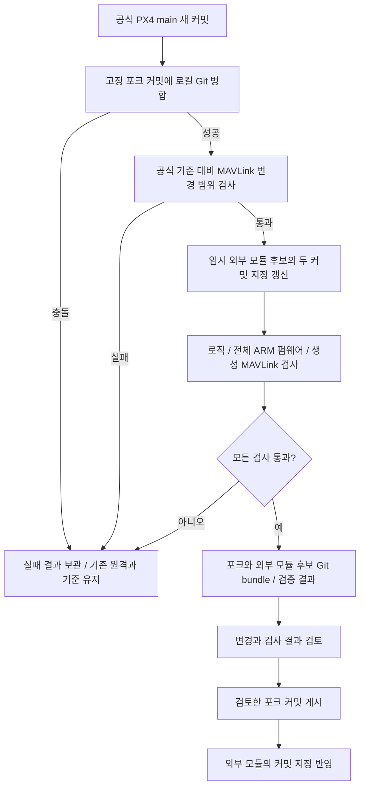

# 외부 센서 모듈과 추가형 MAVLink 확장

센서 드라이버는 이 저장소에서 관리하고 PX4의 EXTERNAL_MODULES_LOCATION과 px4_add_module(... EXTERNAL)로 펌웨어에 포함합니다. 센서가 발행한 uORB 측정값을 MAVLink로 보내는 확장은 VIPSfef/Firmware 포크에서 관리합니다. [공식 외부 모듈 문서](https://docs.px4.io/main/en/advanced/out_of_tree_modules)

## Git에서 관리하는 경계

| 항목 | 외부 모듈 저장소 | PX4 포크 |
| --- | --- | --- |
| 센서 읽기 | SHTC3 드라이버·진단 명령·파라미터 | PX4 I2C·WorkQueue·uORB API 제공 |
| MAVLink 송신 | HYRUS_MAVLINK를 기본으로 활성화 | 선택 가능한 스트림·메시지 정의 추가 |
| 빌드 | 직접 CMake 스크립트와 선택적인 고정 조합 검증 | PX4 전체 컴파일·링크 |
| 부팅 시 센서 시작 | SD 카드 etc/extras.txt 예제 | 정상 PX4 부팅 절차 유지 |
| 업데이트 | 공식 기준과 포크 커밋을 manifest에 기록 | 공식 main 이력 위에 MAVLink 확장 커밋 유지 |

Firmware/master는 공식 코드 동기화용입니다. hyrus/mavlink는 공식 main을 추적하면서 MAVLink 확장을 유지하는 브랜치입니다. hyrus-mavlink-addon-v1 태그는 최종 확장 변경만 담은 단일 커밋으로, 다른 PX4 브랜치에 이식할 때 사용합니다.

## 직접 빌드와 고정 조합 검증

~~~mermaid
flowchart TD
    D[사용자가 선택한 PX4 작업본] --> BS[build.sh]
    BS --> PRE{도구·submodule·캐시가 맞는가?}
    PRE -->|아니오| STOP[원인 출력 / 소스 보존 / 중단]
    PRE -->|예| C[CMake configure]
    C --> E[외부 센서 모듈 연결]
    E --> ARM[전체 ARM 컴파일·링크]
    ARM --> F[.px4 펌웨어]

    P[project.json의 공식 기준·포크 커밋] --> PREP[firmware.py prepare]
    PREP --> EXACT{공식 이력과 MAVLink 변경 범위가 맞는가?}
    EXACT -->|아니오| STOP
    EXACT -->|예| TEST[validate.py의 소스·native 검사]
    TEST --> BS
    F -->|validate.py 경로만| W[생성 패킷·최종 링크·파라미터 검사]
    W --> REPORT[고정 조합 검증 보고서]
~~~

직접 빌드 스크립트는 Git 상태를 선택하거나 다운로드하지 않습니다. 다른 사용자 펌웨어를 지정해 빌드할 때도 해당 체크아웃을 유지합니다. 원시 CMake 명령과 스크립트 옵션은 [README](../README.md)에 있습니다.

고정 조합 검증은 공식 main의 특정 커밋과 HyRUS 포크 사이에 허용한 MAVLink 변경만 있는지 검사합니다. 사용자가 비행 제어 등을 추가 수정한 별도 펌웨어는 이 검증 정책의 대상이 아닙니다. 해당 펌웨어에는 확장을 이식하고 직접 빌드한 뒤 그 펌웨어의 테스트를 수행합니다.

Python은 PX4 빌드가 코드 생성·패키징에 사용하는 PC 도구입니다. 우리 Python 준비·검증 스크립트는 직접 CMake 빌드의 필수 진입점이 아닙니다.

## 기존 동작을 유지하는 MAVLink 연결

~~~mermaid
flowchart TD
    BASE[보드·기존 펌웨어가 선택한 MAVLink dialect] --> ON{HYRUS_MAVLINK?}
    ON -->|OFF| ORIGINAL[기존 dialect와 스트림 그대로 빌드]
    ON -->|ON| WRAP[기존 dialect + ASLUAV wrapper 생성]
    WRAP --> GEN[로컬 hyrus 메시지 헤더 생성]
    GEN --> REGISTER[SENS_ATMOS 스트림 추가 등록]
    REGISTER --> DEFAULT[config·onboard 기본 송신에 추가]
    ORIGINAL --> BUILD[펌웨어 빌드]
    DEFAULT --> BUILD
~~~

포크의 HYRUS_MAVLINK 옵션은 기본 OFF입니다. 이 센서 외부 모듈을 선택하면 기본 ON이며, 사용자가 명시한 OFF를 존중합니다. 기존 CONFIG_MAVLINK_DIALECT는 유지합니다. 확장을 켰을 때 MAVLink 모듈만 선택된 기본 dialect와 공식 ASLUAV 정의를 포함한 hyrus 헤더를 생성합니다.

Portable addon은 기존 HYGROMETER_SENSOR 처리와 기본 송신 설정을 유지합니다. SENS_ATMOS는 USB/config·onboard 기본 스트림에 추가됩니다. 다른 모드의 기존 송신 설정을 덮어쓰지 않습니다.

다른 펌웨어로 옮기는 addon의 순변경은 다음 여섯 파일입니다.

| src/modules/mavlink/ 아래 경로 | 역할 |
| --- | --- |
| CMakeLists.txt | 선택적인 확장과 로컬 primary dialect 연결 |
| mavlink_messages.cpp | SENS_ATMOS 스트림 추가 등록 |
| mavlink_main.cpp | 기존 기본 스트림에 SENS_ATMOS 추가 |
| streams/SENS_ATMOS.hpp | 새롭고 유효한 온습도 표본 송신 |
| hyrus/dialect.cmake | 선택된 기본 dialect를 보존하는 생성 절차 |
| hyrus/hyrus.xml.in | 기본 dialect와 ASLUAV를 포함할 XML template |

검증용 hyrus/mavlink 추적 브랜치는 위 추가분과 별개로 streams/HYGROMETER_SENSOR.hpp의 습도 직렬화 단위를 공식 규격인 0.01 %RH에 맞추는 수정도 포함합니다. 이 수정은 별도 커밋으로 관리하며 portable addon 태그에서는 제외합니다. 따라서 현재 추적 브랜치의 전체 허용 변경 범위는 MAVLink 파일 일곱 개입니다. 다른 PX4 버전에서는 같은 단위 문제가 남아 있는지 확인한 뒤 이 수정을 별도로 반영합니다.

보드 설정, rc.sensors, 센서 장치 등록부, 비행 제어 파일은 이 확장의 변경 대상이 아닙니다. 센서 소스는 PX4 트리로 복사하지 않습니다. MAVLink 연결은 포크에서 관리하는 추가 코드이며, PX4가 임의의 외부 스트림을 자동 등록하는 기능은 아닙니다. [공식 스트림 등록 지침](https://docs.px4.io/main/en/mavlink/streaming_messages)

## 다른 PX4 기반 펌웨어로 옮기는 흐름

~~~mermaid
flowchart LR
    OFFICIAL[공식 PX4 기준] --> TRACK[main 추적용 포크 + MAVLink 확장]
    TRACK -->|기준 대비 확장 변경만 단일 커밋으로 정리| TAG[hyrus-mavlink-addon-v1]
    USER[사용자가 선택한 PX4 버전·커스텀 브랜치] --> CUSTOM[사용자 통합 브랜치]
    TAG -->|cherry-pick: 커밋의 변경만 적용| CUSTOM
    CUSTOM --> CHECK[충돌 해결 / 직접 빌드 / 사용자 펌웨어 시험]
    UP[사용자가 선택한 원본 펌웨어 업데이트] -->|통합 브랜치에 병합| CUSTOM
~~~

추적 브랜치 전체를 다른 오래된 브랜치에 병합하면 그 사이의 공식 PX4 이력까지 함께 들어옵니다. 추가 기능만 이식할 때는 addon 태그의 커밋을 cherry-pick합니다. 기존 사용자 펌웨어의 변경·버전 선택을 보존하는 방법입니다.

이 구조는 이식할 변경 범위를 작게 유지하지만 모든 버전의 호환성을 보장하지는 않습니다. uORB·MAVLink API, 메시지 ID·정의, CMake 구조가 달라지면 충돌 해결과 수정이 필요합니다. 명령은 README의 다른 PX4 버전 이식 절차를 따릅니다. ArduPilot 등 다른 계열에는 이 PX4 모듈을 그대로 적용할 수 없습니다.

## 센서 실행과 데이터 흐름

드라이버는 PX4 I2C·WorkQueue·uORB API를 사용합니다. 센서 변환을 기다리는 동안 공유 WorkQueue를 긴 sleep으로 점유하지 않습니다. 물리 버스 번호는 보드와 배선에 따라 정해야 하며, 제공한 시작 예제의 버스 2가 모든 기기에 맞는 것은 아닙니다.

현재 온습도 송신 계약은 센서 한 개, `sensor_hygrometer` instance 0입니다. 다른 습도계가 먼저 instance 0을 점유하면 그 값이 선택될 수 있으므로 다중 센서는 별도 선택 정책이 필요합니다. 표본 시간은 부팅 후 측정 시각이며 Router의 마지막 수신 이후 경과 시간과 구분합니다.

## 공식 main 추적

후보 준비는 작업 디렉터리의 분리된 HEAD에서 수행합니다. 원격 포크 브랜치와 외부 모듈의 기본 브랜치를 자동으로 옮기지 않습니다. 공식 함수·uORB·MAVLink 정의가 바뀌면 포크 또는 외부 모듈 소스를 수정해야 할 수 있으며, Git 병합 성공만으로 호환된다고 판정하지 않습니다.

검사는 두 저장소를 읽는 권한으로 실행하고, 통과한 후보를 두 개의 Git bundle로 보관합니다. 포크에 없는 후보 커밋을 외부 모듈의 일반 빌드 기준으로 먼저 게시하면 소스를 받을 수 없으므로, 검토 후 **포크 커밋 게시 → 외부 모듈 manifest 반영** 순서를 지킵니다. PR 생성·자동 병합·기체 업로드는 이 검사의 동작에 포함하지 않습니다.

| 검사 | 확인 범위 | 별도로 필요한 확인 |
| --- | --- | --- |
| native 테스트 | 프로토콜·진단·포크 스트림 로직 | 실제 PX4 API와 하드웨어 |
| 생성 헤더 패킷 검사 | 실제 MAVLink 메시지 ID·CRC·직렬화·단위 | 물리 통신 링크 |
| 전체 ARM 빌드 | 모듈 포함·컴파일·링크·펌웨어 생성 | 보드 부팅·센서 응답·시간 특성 |
| 기기 시험 | 실제 배선·시작·중단·단절 복구 | 다른 보드와 운용 조건 |

검증 결과는 외부 모듈 커밋·포크 커밋·공식 기준 커밋의 조합에 해당합니다. 과거 v1.16의 성공 기록은 최신 main의 검사 결과를 대신하지 않습니다.
