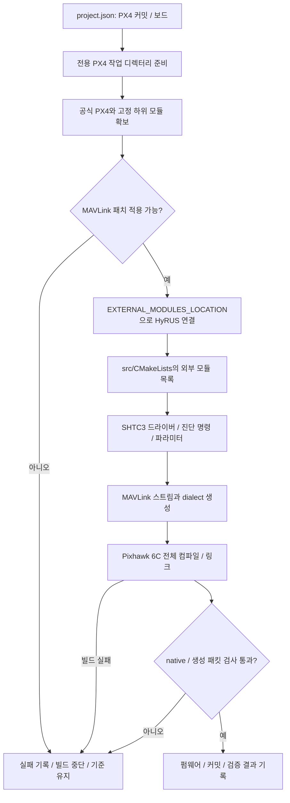
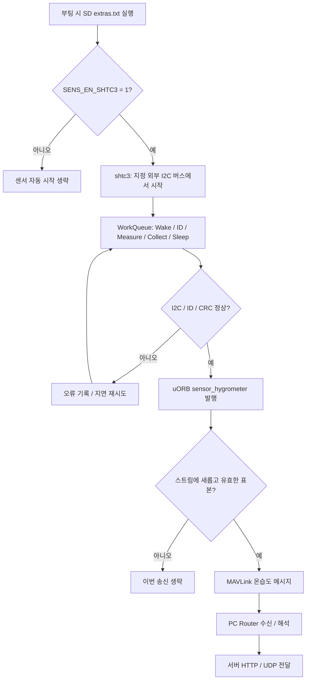
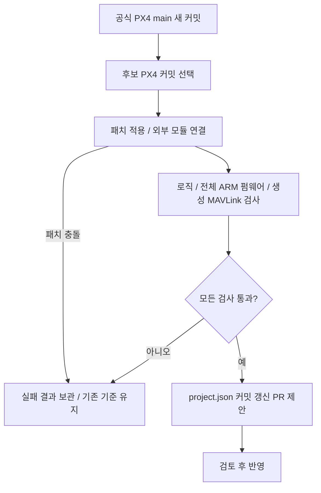

# 외부 모듈 구조와 검증 흐름

HyRUS는 센서 코드를 별도 Git 저장소에서 관리하고, PX4의 `EXTERNAL_MODULES_LOCATION`과 `px4_add_module(... EXTERNAL)`로 펌웨어에 포함합니다. PX4 내부 모듈과 같은 헤더를 사용할 수 있고 측정값은 uORB로 전달합니다. [공식 외부 모듈 문서](https://docs.px4.io/main/en/advanced/out_of_tree_modules)

## 변경 전후

| 항목 | 이전 PX4 소스 내장 방식 | 현재 외부 모듈 방식 |
| --- | --- | --- |
| 센서 소스 | PX4 원본 트리에 추가 | HyRUS 저장소의 `src/`에서 관리 |
| 센서 빌드 선택 | PX4 보드·Kconfig 연결 | 외부 모듈 목록과 `EXTERNAL` 연결 |
| 부팅 시 시작 | PX4 `rc.sensors` 수정 | SD 카드 `etc/extras.txt` 예제 |
| PX4 기준 버전 | 커스텀 펌웨어 브랜치 이력 | `project.json`의 공식 PX4 커밋 |
| 원본 수정 범위 | 드라이버·보드·부팅·MAVLink | MAVLink 파일 4개 |
| 업데이트 후보 | PX4 전체 브랜치 병합 | 새 공식 커밋에 패치·외부 모듈 연결 후 검증 |

기존 작업은 `archive/overlay-v1.16`과 `archive/in-tree-v1.16`에 보존합니다. 현재 `main`은 외부 모듈 소스를 관리합니다. GitHub의 오래된 `VIPSfef/Firmware` 포크는 이 빌드의 기준 소스가 아닙니다.

## 빌드 흐름과 실패 처리

센서 파일을 PX4 드라이버 디렉터리로 복사하지 않습니다. 공식 PX4 파일 중 패치 대상은 다음 네 파일입니다.

- `src/modules/mavlink/CMakeLists.txt`: HyRUS 스트림·dialect 빌드 연결
- `src/modules/mavlink/mavlink_messages.cpp`: SENS_ATMOS 스트림 등록
- `src/modules/mavlink/mavlink_main.cpp`: 필요한 기본 스트림 설정
- `src/modules/mavlink/streams/HYGROMETER_SENSOR.hpp`: 표준 습도 필드의 단위 변환

보드 설정, `rc.sensors`, `drv_sensor.h`는 이 패치의 대상이 아닙니다. `mavlink/`의 소스 연결은 HyRUS가 관리하는 빌드 확장이며, PX4가 임의의 외부 MAVLink 스트림을 자동 발견한다는 뜻은 아닙니다. 공식 스트림 작성 지침도 기존 MAVLink 스트림 목록에 등록하는 절차를 설명합니다. [공식 스트림 등록 지침](https://docs.px4.io/main/en/mavlink/streaming_messages)

## 센서 실행과 데이터 흐름

드라이버는 PX4 I2C·WorkQueue·uORB API를 사용합니다. 센서 변환을 기다리는 동안 공유 WorkQueue를 긴 sleep으로 점유하지 않습니다. 물리 버스 번호는 보드와 배선에 따라 정해야 하며, 제공한 시작 예제의 버스 2가 모든 기기에 맞는 것은 아닙니다.

현재 온습도 송신 계약은 센서 한 개, `sensor_hygrometer` instance 0입니다. 다른 습도계가 먼저 instance 0을 점유하면 그 값이 선택될 수 있으므로 다중 센서는 별도 선택 정책이 필요합니다. 표본 시간은 부팅 후 측정 시각이며 Router의 마지막 수신 이후 경과 시간과 구분합니다.

## 공식 main 추적

자동화는 검증하지 않은 PX4로 기준 커밋을 교체하지 않습니다. upstream의 함수·uORB·MAVLink 정의가 바뀌면 패치 또는 외부 모듈을 수정해야 할 수 있습니다. PR이 만들어져도 자동 병합하거나 기체에 업로드하지 않습니다.

| 검사 | 확인 범위 | 별도로 필요한 확인 |
| --- | --- | --- |
| native 테스트 | 프로토콜·진단·스트림 로직 | 실제 PX4 API와 하드웨어 |
| 생성 헤더 패킷 검사 | 실제 MAVLink 메시지 ID·CRC·직렬화·단위 | 물리 통신 링크 |
| 전체 ARM 빌드 | 모듈 포함·컴파일·링크·펌웨어 생성 | 보드 부팅·센서 응답·시간 특성 |
| 기기 시험 | 실제 배선·시작·중단·단절 복구 | 다른 보드와 운용 조건 |

검증 결과는 검사한 HyRUS 커밋과 PX4 커밋의 조합에만 해당합니다. 과거 내장 방식의 성공 기록은 외부 모듈 방식의 현재 검사 결과를 대신하지 않습니다.
