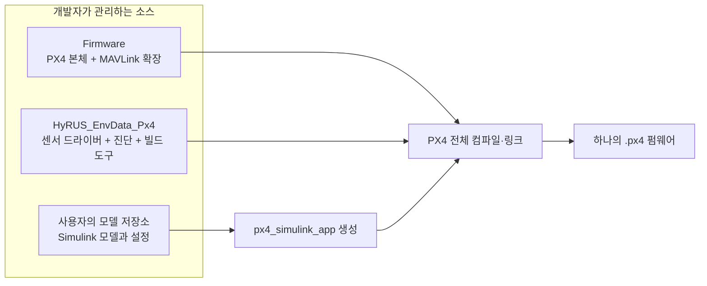
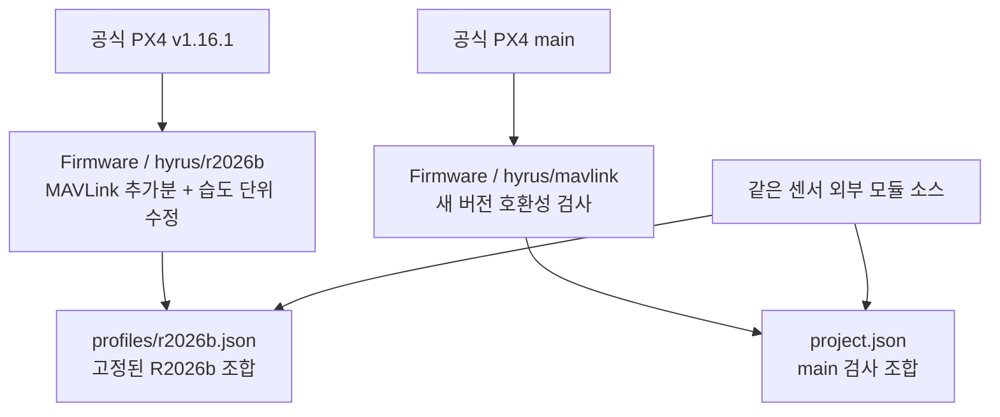
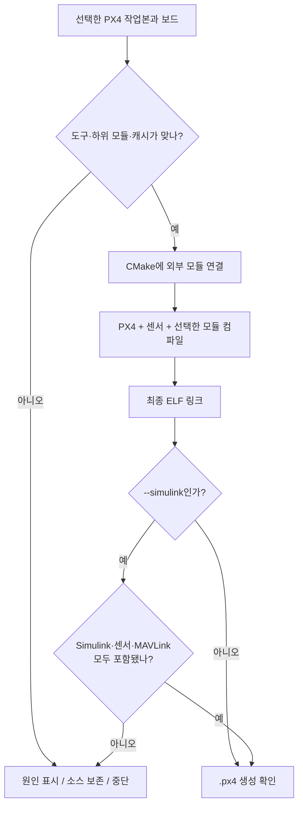
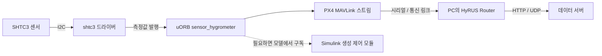

# 저장소 관계와 데이터 흐름

이 문서는 **무엇을 어디서 고치고, 무엇이 함께 빌드되며, 센서 값이 어디로 이동하는지** 설명합니다. 실행 명령은 [R2026b 작업 안내](simulink-r2026b.md), 버전 기록은 [포크 안내](fork-comparison.md)에 있습니다.

## 1. 저장소는 나뉘고 펌웨어는 하나입니다

| 수정하려는 내용 | 수정할 곳 |
| --- | --- |
| SHTC3 측정·CRC·복구·uORB 발행 | 이 저장소의 `src/drivers/hygrometer/shtc3` |
| I2C 연결 진단 명령 | 이 저장소의 `src/systemcmds/shtc3_probe` |
| 온습도 MAVLink 메시지·스트림 등록 | 포크의 `src/modules/mavlink` |
| 사용자 제어 알고리즘 | 사용자 Simulink 모델 |
| PC에서 받은 값을 HTTP·UDP로 전달 | 별도 `HyRUS_EnvData_Router` 저장소 |

센서 소스를 PX4 내부로 복사하지 않습니다. PX4의 `EXTERNAL_MODULES_LOCATION`과 `px4_add_module(... EXTERNAL)`로 빌드에 연결합니다. Simulink 생성 코드는 지원 패키지가 PX4 모듈로 등록합니다. [PX4 외부 모듈](https://docs.px4.io/v1.16/en/advanced/out_of_tree_modules), [MathWorks 통합 방식](https://www.mathworks.com/help/uav/px4/ug/px4-capabilities-integration.html)

## 2. R2026b 기준과 최신 main은 따로 움직입니다

`main` 검사가 성공해도 R2026b 기준을 자동으로 올리지 않습니다. MATLAB 지원 버전을 바꿀 때는 그 버전용 통합 브랜치를 별도로 준비합니다. 사용자 모델 작업본은 고정 조합 CI의 임시 작업본과 분리합니다.

## 3. 빌드할 때 일어나는 일

일반 `build.sh`는 지정한 작업본을 그대로 빌드합니다. `--simulink`는 생성 모듈의 존재와 최종 링크를 추가로 확인합니다. Simulink가 새 코드를 만든 뒤 다시 실행하여 외부 모듈 연결을 복원하고 최종 파일을 검사합니다. 사용자 소스의 Git 브랜치를 바꾸지는 않습니다.

`firmware.py prepare`와 `validate.py`는 **프로필에 기록된 조합을 재현하는 CI 경로**입니다. 커밋 선택, 변경 범위 검사, 테스트, ARM 전체 빌드와 보고서를 수행합니다. 사용자 모델 작업본을 이 경로에 넣지 않습니다.

Python은 PX4가 코드 생성과 포장에 사용하는 PC 의존성입니다. 최종 기체에서는 생성·컴파일된 C/C++ 코드가 실행됩니다.

## 4. MAVLink 확장은 기존 설정 위에 추가됩니다

포크의 확장 옵션 기본값은 OFF이고, 센서 외부 모듈을 연결하면 기본 ON입니다. 명시한 OFF는 존중합니다. `--simulink`는 통합 결과를 확인하기 위해 확장을 ON으로 지정합니다.

추가분은 기존 `CONFIG_MAVLINK_DIALECT`, `HYGROMETER_SENSOR` 기본 스트림, 다른 모드의 설정을 유지합니다. 별도의 습도 단위 수정은 `HYGROMETER_SENSOR`의 값을 공식 규격인 0.01 %RH로 인코딩하게 합니다.

| 포크의 MAVLink 경로 | 역할 |
| --- | --- |
| `CMakeLists.txt`, `hyrus/dialect.cmake`, `hyrus/hyrus.xml.in` | 기존 메시지 구성을 보존하면서 확장 헤더 생성 |
| `mavlink_messages.cpp` | 새 스트림 등록 |
| `mavlink_main.cpp` | 기존 기본 스트림 목록에 추가 |
| `streams/SENS_ATMOS.hpp` | 새롭고 유효한 온습도 표본 송신 |
| `streams/HYGROMETER_SENSOR.hpp` | 별도로 관리하는 습도 단위 수정 |

HyRUS 이식은 비행 제어·보드·기본 부팅 코드를 변경하지 않습니다. Simulink 지원 패키지가 제어 모듈과 부팅 구성을 바꾸는 것은 별도의 사용자 모델 통합 과정입니다.

## 5. 센서 값이 서버까지 가는 경로

드라이버는 측정 상태, CRC와 통신 오류를 검사하고 새 표본을 발행합니다. 센서 변환을 기다리는 동안 PX4 공유 WorkQueue를 긴 sleep으로 점유하지 않습니다. MAVLink 스트림은 새롭고 유효한 표본을 송신하며, Router가 이를 서버용 데이터로 변환합니다.

현재 `SENS_ATMOS` 송신은 `sensor_hygrometer` instance 0 한 개를 사용합니다. 다른 습도계가 먼저 instance 0을 차지하면 그 값이 선택될 수 있으므로 다중 센서는 별도 선택 정책이 필요합니다. 표본의 부팅 후 측정 시각과 Router의 마지막 수신 이후 경과 시간은 서로 다른 값입니다.

## 6. 부팅과 통신은 별도로 확인합니다

빌드에 들어간 모듈도 부팅 과정에서 실행되어야 합니다. 기본 PX4 부팅에서는 `sdcard/etc/extras.txt` 예제를 실제 배선에 맞춰 합칩니다. 사용자 `rc.txt`를 쓰는 Simulink 모델은 해당 스크립트에서 센서와 MAVLink의 시작을 확인합니다.

센서 전송만을 위해 Simulink 모델에 I2C 읽기 블록을 다시 만들 필요는 없습니다. 제어 알고리즘이 온습도를 사용한다면 드라이버가 발행하는 uORB 토픽을 구독하는 방식으로 연결할 수 있습니다.

## 7. 검사 결과가 의미하는 범위

| 검사 | 확인하는 것 | 이 검사만으로 확인되지 않는 것 |
| --- | --- | --- |
| native 테스트 | 센서 프로토콜·진단·MAVLink 스트림 로직 | 실제 I2C 배선과 센서 응답 |
| 생성 MAVLink 패킷 검사 | 메시지 ID·CRC·직렬화·단위 | 실제 링크의 손실·대역폭 |
| 전체 ARM 빌드 | 해당 PX4·센서·MAVLink의 컴파일·링크 | 보드 부팅·비행 동작 |
| `--simulink` 링크 검사 | 생성 제어 모듈과 센서·MAVLink가 최종 ELF에 함께 포함 | Simulink 모델의 제어 성능과 실기 동작 |
| 실제 기기·모델 시험 | 해당 모델·보드·배선에서의 동작 | 다른 모델과 버전의 자동 호환성 |

프로필의 검사 결과는 **외부 모듈 커밋 + PX4 포크 커밋 + 보드 구성**에 해당합니다. MATLAB에서 생성한 실제 모델까지 시험한 결과와 구분해서 기록합니다. 공식 main 업데이트 검사 순서는 [CI 운영 안내](../Tools/hyrus/CI.md)에 있습니다.
