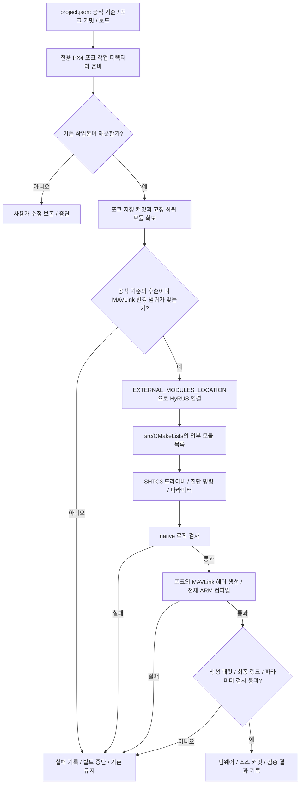
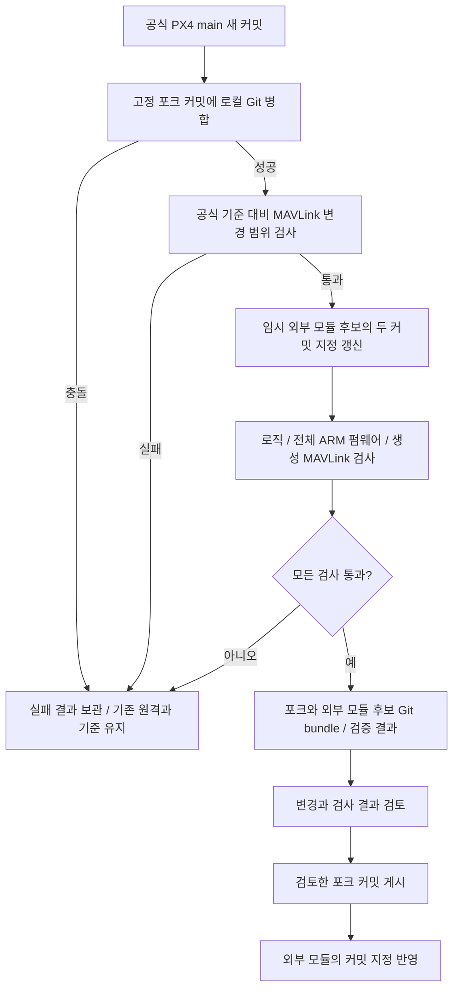

# 외부 센서 모듈과 PX4 포크의 관계

센서 드라이버는 이 저장소에서 관리하고 PX4의 `EXTERNAL_MODULES_LOCATION`과 `px4_add_module(... EXTERNAL)`로 펌웨어에 포함합니다. 센서가 발행한 uORB 측정값을 MAVLink로 보내는 코드는 `VIPSfef/Firmware` 포크에서 관리합니다. [공식 외부 모듈 문서](https://docs.px4.io/main/en/advanced/out_of_tree_modules)

## Git에서 관리하는 경계

| 항목 | 외부 모듈 저장소 | PX4 포크 |
| --- | --- | --- |
| 센서 읽기 | SHTC3 드라이버·진단 명령·파라미터 | PX4 I2C·WorkQueue·uORB API 제공 |
| MAVLink 송신 | 포크가 제공하는 메시지 정의를 선택 | 스트림·dialect·등록·기본 송신 설정 |
| 빌드 | 지정 커밋 준비·테스트·검증 보고서 | PX4 전체 컴파일·링크 |
| 부팅 시 센서 시작 | SD 카드 `etc/extras.txt` 예제 | 정상 PX4 부팅 절차 유지 |
| 업데이트 | 공식 기준과 포크 커밋을 manifest에 기록 | 공식 main 이력과 MAVLink 변경 커밋 |

`Firmware/master`는 공식 코드 동기화용입니다. `Firmware/hyrus/mavlink`는 공식 이력 위에 MAVLink 변경을 유지하는 브랜치입니다. 실제 빌드는 `project.json`의 전체 SHA로 고정한 포크 커밋을 사용합니다. 센서 소스는 PX4 트리로 복사하지 않습니다.

이전에는 매번 공식 PX4를 받고 `git apply`로 패치를 적용했습니다. 현재는 MAVLink 수정 자체가 포크 커밋이므로 준비 단계에 패치 적용이 없습니다. 코드 수정이 사라진 것이 아니라, Git에서 관리할 위치가 포크로 이동한 것입니다. 공식 PX4가 임의의 외부 스트림을 자동 등록하는 구조는 아닙니다. [공식 스트림 등록 지침](https://docs.px4.io/main/en/mavlink/streaming_messages)

## 빌드 흐름과 실패 처리

포크의 변경 범위는 다음 `src/modules/mavlink/` 파일로 제한합니다.

| 포크 내부 경로 | 역할 |
| --- | --- |
| `CMakeLists.txt` | 포크의 dialect 빌드 연결 |
| `mavlink_messages.cpp` | SENS_ATMOS 스트림 등록 |
| `mavlink_main.cpp` | 필요한 기본 송신 설정 |
| `streams/HYGROMETER_SENSOR.hpp` | 표준 습도 필드의 단위 변환 |
| `streams/SENS_ATMOS.hpp` | 새롭고 유효한 온습도 표본 송신 |
| `hyrus/dialect.cmake` | 공식 XML과 weather wrapper로 헤더 생성 |
| `hyrus/weather.xml` | 공식 development와 ASLUAV 정의 연결 |

보드 설정, `rc.sensors`, 센서 장치 등록부, 비행 제어 파일은 HyRUS를 위해 변경하지 않습니다. 준비·검증 도구는 공식 기준과 포크 사이의 실제 Git 차이를 검사합니다.

외부 모듈의 `src/CMakeLists.txt`는 필요한 포크 연결이 있는지 검사하고, 센서 모듈 목록과 `weather` dialect를 선택합니다. 포크의 MAVLink 빌드가 그 정의로 헤더를 생성합니다. 순정 PX4 또는 다른 dialect를 사용하는 구성과 HyRUS 구성을 구분해 연결합니다.

## 센서 실행과 데이터 흐름

드라이버는 PX4 I2C·WorkQueue·uORB API를 사용합니다. 센서 변환을 기다리는 동안 공유 WorkQueue를 긴 sleep으로 점유하지 않습니다. 물리 버스 번호는 보드와 배선에 따라 정해야 하며, 제공한 시작 예제의 버스 2가 모든 기기에 맞는 것은 아닙니다.

현재 온습도 송신 계약은 센서 한 개, `sensor_hygrometer` instance 0입니다. 다른 습도계가 먼저 instance 0을 점유하면 그 값이 선택될 수 있으므로 다중 센서는 별도 선택 정책이 필요합니다. 표본 시간은 부팅 후 측정 시각이며 Router의 마지막 수신 이후 경과 시간과 구분합니다.

## 공식 main 추적

후보 준비는 작업 디렉터리의 분리된 HEAD에서 수행합니다. 원격 포크 브랜치와 외부 모듈의 기본 브랜치를 자동으로 옮기지 않습니다. 공식 함수·uORB·MAVLink 정의가 바뀌면 포크 또는 외부 모듈 소스를 수정해야 할 수 있으며, Git 병합 성공만으로 호환된다고 판정하지 않습니다.

검사는 두 저장소를 읽는 권한으로 실행하고, 통과한 후보를 두 개의 Git bundle로 보관합니다. 포크에 없는 후보 커밋을 외부 모듈의 일반 빌드 기준으로 먼저 게시하면 소스를 받을 수 없으므로, 검토 후 **포크 커밋 게시 → 외부 모듈 manifest 반영** 순서를 지킵니다. PR 생성·자동 병합·기체 업로드는 이 검사의 동작에 포함하지 않습니다.

| 검사 | 확인 범위 | 별도로 필요한 확인 |
| --- | --- | --- |
| native 테스트 | 프로토콜·진단·포크 스트림 로직 | 실제 PX4 API와 하드웨어 |
| 생성 헤더 패킷 검사 | 실제 MAVLink 메시지 ID·CRC·직렬화·단위 | 물리 통신 링크 |
| 전체 ARM 빌드 | 모듈 포함·컴파일·링크·펌웨어 생성 | 보드 부팅·센서 응답·시간 특성 |
| 기기 시험 | 실제 배선·시작·중단·단절 복구 | 다른 보드와 운용 조건 |

검증 결과는 외부 모듈 커밋·포크 커밋·공식 기준 커밋의 조합에 해당합니다. 과거 v1.16의 성공 기록은 최신 main의 검사 결과를 대신하지 않습니다.
