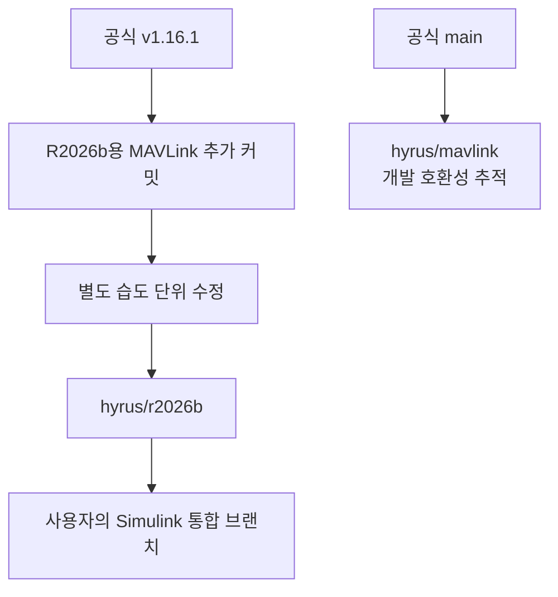

# PX4 포크와 브랜치 관리

기록일: **2026-10-27 (한국 시간)**. 대상은 [VIPSfef/Firmware](https://github.com/VIPSfef/Firmware)입니다. 센서 외부 모듈 저장소인 `HyRUS_EnvData_Px4`와 역할이 다릅니다.

## R2026b 작업에 사용할 기준

**Simulink R2026b 작업은 `hyrus/r2026b`를 사용합니다.** 공식 PX4 v1.16.1 위에 MAVLink 추가분을 이식한 브랜치입니다. 최신 공식 main과의 차이는 별도의 `hyrus/mavlink`에서 추적합니다.



| 대상 | 역할 |
| --- | --- |
| `Firmware/hyrus/r2026b` | PX4 v1.16.1을 유지하는 R2026b용 MAVLink 포크 |
| `hyrus-mavlink-addon-px4-v1.16.1` 태그 | v1.16.1에 맞춰 이식한 MAVLink 추가분만 선택할 때 사용 |
| `Tools/hyrus/profiles/r2026b.json` | R2026b 검증에 사용할 공식 기준과 포크 커밋 |
| `Firmware/hyrus/mavlink` | 최신 공식 main과의 호환성을 검사하는 개발 브랜치 |
| `Tools/hyrus/project.json` | main 추적용 검증 조합 |
| `Firmware/master` | 공식 코드 동기화용 브랜치 |
| 사용자의 모델 통합 브랜치 | Simulink 생성·보드·부팅 변경을 포함한 사용자 작업 |

외부 센서 모듈 소스는 두 프로필에서 함께 사용합니다. 고정 조합 검사와 사용자 작업을 분리하므로 main 업데이트 검사가 사용자 모델 작업본을 바꾸지 않습니다.

## v1.16.1 이식 기록

| 항목 | 커밋 |
| --- | --- |
| 공식 PX4 v1.16.1 | [`94cb2012792b2ae89f0b147cfee53ee31ae550be`](https://github.com/PX4/PX4-Autopilot/commit/94cb2012792b2ae89f0b147cfee53ee31ae550be) |
| MAVLink 추가분만 가져오는 태그 | [`hyrus-mavlink-addon-px4-v1.16.1`](https://github.com/VIPSfef/Firmware/tree/hyrus-mavlink-addon-px4-v1.16.1) → `0d0c345520dbd1fc163714843249417662f05ad1` |
| 통합 브랜치의 실제 MAVLink 추가 커밋 | [`713b77987a3c8d8002196cca2a602ecb4dbfb59e`](https://github.com/VIPSfef/Firmware/commit/713b77987a3c8d8002196cca2a602ecb4dbfb59e) |
| 습도 단위 수정까지 포함한 이식 기준 | [`5c54f2e0c0ec4ce6ac8b943a025b483796561062`](https://github.com/VIPSfef/Firmware/commit/5c54f2e0c0ec4ce6ac8b943a025b483796561062) |

현재 검증 기준은 프로필 파일을 확인합니다. 위 표는 최초 이식 기록이며, 이후 수정으로 브랜치 끝이 움직여도 기록의 기준은 바뀌지 않습니다.

추가분 태그는 통합 브랜치와 분리한 스냅샷 커밋을 가리킵니다. 내용은 같은 여섯 파일의 추가분이며, 별도 태그가 통합 펌웨어의 `git describe`에 선택되지 않아 공식 v1.16.1 태그를 기준으로 버전을 인식하게 합니다.

MAVLink 추가 커밋은 기존 메시지 구성과 기본 스트림을 유지하면서 `SENS_ATMOS`를 추가합니다. 변경 범위는 MAVLink 경로의 여섯 파일입니다. 그다음 커밋은 `HYGROMETER_SENSOR`의 습도를 공식 단위인 0.01 %RH로 직렬화하는 한 파일의 별도 수정입니다.

SHTC3 드라이버·진단·파라미터는 외부 모듈 저장소에서 관리합니다. PX4 보드 설정, 기본 부팅 및 비행 제어 코드는 이 MAVLink 이식의 변경 대상이 아닙니다. Simulink가 사용자 모델을 위해 만드는 변경은 사용자 작업 브랜치에서 관리합니다.

## 이미 가진 PX4 v1.16.1 커스텀 펌웨어에 넣을 때

새로 시작하면 README의 `hyrus/r2026b` 복제 절차를 사용합니다. 이미 사용자 변경이 있는 v1.16.1 기반 PX4가 있다면 추가 커밋만 가져올 수 있습니다.

먼저 사용자 변경을 커밋한 상태에서 새 통합 브랜치를 만듭니다. 아래는 **사용자의 PX4 저장소 안에서** 실행합니다.

```sh
git status --short
git switch -c surveyor-r2026b

git fetch https://github.com/VIPSfef/Firmware.git refs/tags/hyrus-mavlink-addon-px4-v1.16.1
git cherry-pick FETCH_HEAD

# 기존 펌웨어에 같은 습도 단위 수정이 없다면 별도로 적용합니다.
git fetch https://github.com/VIPSfef/Firmware.git refs/heads/hyrus/r2026b
git cherry-pick 5c54f2e0c0ec4ce6ac8b943a025b483796561062

git submodule update --init --recursive
```

첫 줄에서 변경이 표시되면 먼저 보존하고 진행합니다. 충돌이 나면 해당 사용자 변경과 API에 맞게 해결하거나 `git cherry-pick --abort`로 시도를 취소합니다. 사용자 커스텀 펌웨어의 완성도는 별도의 빌드·모델·기기 시험으로 확인합니다.

이후 센서 저장소의 `build.sh --px4-dir ...`로 같은 작업본을 빌드합니다. Simulink 모델까지 넣을 때는 [R2026b 안내](simulink-r2026b.md)의 `--simulink` 절차를 따릅니다.

기존 `hyrus-mavlink-addon-v1` 태그는 공식 main의 `a743c7b...` 기준으로 만든 원래 추가분입니다. 다른 버전에 이식할 때 참고할 수 있지만, v1.16.1에는 위의 **버전에 맞춰 이식한 커밋**을 사용합니다. 다른 버전으로 옮길 때는 API와 CMake 변경을 다시 확인해야 합니다.

## 업데이트 규칙

- **R2026b 작업:** v1.16.1 기반을 유지하면서 센서·MAVLink 수정만 검토해 반영합니다.
- **공식 main 추적:** 별도 후보에서 병합·native 테스트·전체 ARM 빌드·패킷 검사를 수행합니다. 성공한 후보를 검토한 뒤 반영합니다.
- **MATLAB 버전 변경:** 새 릴리스가 지원하는 PX4 버전을 확인하고 별도 통합 브랜치에서 준비합니다.
- **사용자 모델 변경:** 모델 원본과 필요한 보드·부팅 설정을 사용자 저장소에 보존하고 최종 펌웨어를 다시 검사합니다.

`hyrus/mavlink` 전체를 R2026b 작업 브랜치에 병합하면 그 안의 최신 공식 PX4 이력까지 들어옵니다. 특정 추가 기능만 옮길 때는 필요한 커밋을 선택합니다. Git 병합 성공과 실제 호환성 검증은 구분합니다.

자동 검사의 명령과 보고서 구조는 [CI 운영 안내](../Tools/hyrus/CI.md)에 있습니다. 원격 포크 커밋을 먼저 게시하고, 그 커밋을 가리키는 외부 모듈 프로필을 나중에 반영해야 다른 PC에서 소스를 받을 수 있습니다.

## 이전 master 갱신 기록

다음은 R2026b 이식 전에 수행한 기존 포크 조사와 갱신 기록입니다. 현재 브랜치 끝을 나타내는 표가 아닙니다.

`Firmware/master`를 공식 PX4 main의 `a743c7b7369873b6530bcd51019477a5fe9659ab`로 fast-forward했습니다. 그때 양쪽 커밋과 소스 트리 SHA가 같고 기존 이력이 보존된 것을 확인했습니다.

| 항목 | 갱신 전 확인 결과 |
| --- | --- |
| 기본 브랜치 | `master` |
| 커밋 | `a40c9831376f31cb560b2d66c49c2067abd67f8a` |
| 커밋 날짜 | 2018-08-06 |
| 내용 | `updated submodule src/lib/DriverFramework` |
| 비교한 공식 main | `a743c7b7369873b6530bcd51019477a5fe9659ab` |
| 공식 main 대비 | 포크에만 있는 커밋 0개 / 공식에 추가된 커밋 24,678개 |
| 공식 v1.16.0 대비 | 포크에만 있는 커밋 0개 / 공식에 추가된 커밋 20,128개 |
| 당시 포크 브랜치 수 | 180개 |

GitHub 비교와 로컬 `git rev-list --left-right --count` 결과를 대조했습니다. 당시 `master`는 공식 main의 조상이었으므로 독자 변경을 옮길 필요 없이 갱신할 수 있었습니다. 나머지 179개 브랜치를 모두 감사하거나 삭제·이름 변경하지는 않았습니다.

근거:

- [갱신 전 마지막 커밋](https://github.com/VIPSfef/Firmware/commit/a40c9831376f31cb560b2d66c49c2067abd67f8a)
- [master 동기화의 공식 기준](https://github.com/PX4/PX4-Autopilot/commit/a743c7b7369873b6530bcd51019477a5fe9659ab)
- [당시 공식 main과의 비교](https://github.com/PX4/PX4-Autopilot/compare/a743c7b7369873b6530bcd51019477a5fe9659ab...a40c9831376f31cb560b2d66c49c2067abd67f8a)
