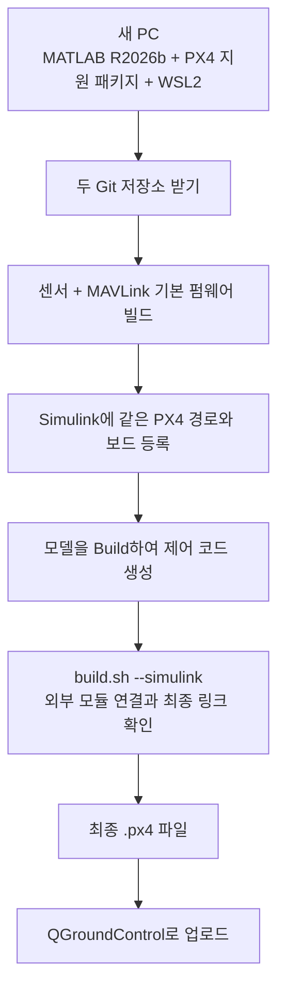
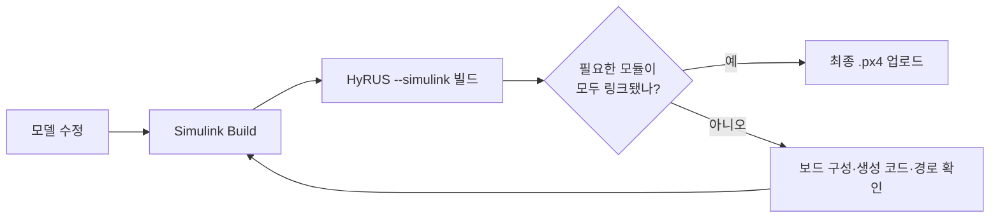

# R2026b / PX4 v1.16.1: 다른 PC에서 시작하기

이 문서는 **Windows의 MATLAB/Simulink R2026b + WSL2의 PX4 빌드 환경 + Pixhawk 6C**를 기준으로 합니다. R2026b PX4 지원 패키지는 공식 **PX4 v1.16.1**을 요구합니다. MATLAB 버전과 PX4 버전을 한 조합으로 관리합니다. [MathWorks 버전 지침](https://www.mathworks.com/help/uav/px4/ug/downloading-px4-source-code-wsl2.html)

완성할 결과물은 하나입니다. 사용자의 Simulink 제어 코드, HyRUS 온습도 드라이버, MAVLink 송신 확장이 같은 펌웨어에 들어갑니다. Router는 PC에서 실행하는 별도 프로그램입니다.

## 1. 전체 작업을 먼저 이해하기



처음 한 번은 개발 환경과 작업 폴더를 준비합니다. 이후에는 **모델 수정 → Simulink Build → HyRUS 검증 빌드 → 업로드**를 반복합니다. 현재 연결 방식은 이 두 빌드 단계를 명시적으로 실행합니다. Simulink의 기본 빌드 버튼 하나만으로 모든 연결을 자동 유지한다고 가정하지 않습니다.

## 2. 개발 환경 준비

Windows에서 MATLAB R2026b의 **Add-Ons → Get Hardware Support Packages**로 `UAV Toolbox Support Package for PX4 Autopilots`를 설치합니다. 설치된 패키지의 **Options → Setup**으로 Hardware Setup을 시작할 수 있습니다. 설치 프로그램이 요구하는 MATLAB 제품과 업로드 도구도 함께 준비합니다. [공식 설치 안내](https://www.mathworks.com/help/uav/px4/ug/install-support-for-px4-windows.html)

Hardware Setup에서 사용할 WSL2 배포판을 정합니다. 아래 Linux 명령은 **그 배포판의 터미널**에서 실행합니다. Ubuntu 22.04를 수동 준비하거나 MathWorks가 제공하는 사전 구성 WSL 환경을 사용할 수 있습니다. 이미 도구가 설치된 환경에서는 같은 도구를 중복 설치할 필요가 없습니다.

소스는 WSL의 `$HOME/src`에 둡니다. Windows의 OneDrive 폴더나 `/mnt/c/...`에서 직접 PX4를 빌드하지 않습니다. MATLAB은 이후 그 WSL 경로를 참조합니다. [WSL 소스 위치 지침](https://www.mathworks.com/help/uav/px4/ug/downloading-px4-source-code-wsl2.html)

```sh
sudo apt update
sudo apt install -y git
mkdir -p "$HOME/src"
cd "$HOME/src"
```

## 3. 두 저장소 받기

아래는 해당 폴더가 아직 없는 새 PC의 명령입니다.

```sh
cd "$HOME/src"
git clone https://github.com/VIPSfef/HyRUS_EnvData_Px4.git
git clone --filter=blob:none --single-branch --branch hyrus/r2026b \
  https://github.com/VIPSfef/Firmware.git PX4-HyRUS-R2026b

HYRUS_PX4_DIR="$HOME/src/PX4-HyRUS-R2026b"
git -C "$HYRUS_PX4_DIR" fetch --no-recurse-submodules --filter=blob:none --tags \
  https://github.com/PX4/PX4-Autopilot.git refs/tags/v1.16.1
git -C "$HYRUS_PX4_DIR" submodule update --init --recursive
```

폴더 관계는 다음과 같습니다.

```text
~/src/
├── HyRUS_EnvData_Px4/      센서 소스·빌드 도구·이 안내서
├── PX4-HyRUS-R2026b/       PX4 v1.16.1 + MAVLink 확장
└── MySurveyorModel/       사용자가 따로 관리하는 Simulink 모델
```

`hyrus/r2026b`에는 v1.16.1에 이식한 MAVLink 추가분이 들어 있습니다. `hyrus/mavlink`는 최신 PX4 main의 호환성을 검사하는 별도 개발 브랜치입니다. Simulink 작업 폴더에 최신 main 브랜치를 합치지 않습니다.

개발 도구가 아직 준비되지 않았다면 MathWorks Hardware Setup의 도구 설치 단계를 따릅니다. MATLAB 없이 기본 펌웨어만 빌드하는 Ubuntu 환경에서는 해당 PX4 소스의 공식 설치 스크립트를 사용할 수 있습니다.

```sh
PIP_CONSTRAINT="$HOME/src/HyRUS_EnvData_Px4/Tools/hyrus/profiles/r2026b-python.txt" \
  bash "$HOME/src/PX4-HyRUS-R2026b/Tools/setup/ubuntu.sh" --no-sim-tools
```

필요한 도구는 Git, CMake·Ninja·Make, ARM GCC·newlib, 호스트 C/C++ 컴파일러, Python 3와 PX4 요구 패키지입니다. Python은 uORB/MAVLink 코드 생성과 펌웨어 포장에 사용하는 PC 도구이며, 센서 드라이버는 C/C++로 컴파일됩니다.

v1.16.1의 기존 DroneCAN 생성기는 `pkg_resources`를 사용합니다. 위 제약 파일은 이를 포함하는 `setuptools 81.0.0`을 선택합니다. 최신 setuptools에서 해당 API가 제거되어 새 PC에서 빌드가 중단되는 문제를 막습니다. PX4 소스나 하위 모듈을 고치는 방식은 아닙니다. [setuptools 변경 내역](https://setuptools.pypa.io/en/stable/history.html#v82-0-0)

MathWorks 도구 설치를 이미 마쳤다면, **같은 WSL 배포판의 빌드용 Python**에도 다음 호환 의존성을 적용합니다. 이 명령의 `PIP_BREAK_SYSTEM_PACKAGES`는 Ubuntu 24.04 등의 Python 패키지 설치 정책에 대응하며, PX4 공식 설치 스크립트와 같은 범위에서 빌드 도구를 설치합니다.

```sh
PIP_BREAK_SYSTEM_PACKAGES=1 python3 -m pip install \
  -r "$HOME/src/HyRUS_EnvData_Px4/Tools/hyrus/profiles/r2026b-python.txt"
```

## 4. 먼저 기본 펌웨어 빌드

Simulink 제어 코드를 넣기 전에 센서와 MAVLink의 빌드 경로부터 확인합니다.

```sh
cd "$HOME/src/HyRUS_EnvData_Px4"
bash Tools/hyrus/build.sh \
  --px4-dir "$HOME/src/PX4-HyRUS-R2026b" \
  --target px4_fmu-v6c_default \
  --jobs 6
```

성공하면 다음 파일이 생깁니다.

```text
~/src/PX4-HyRUS-R2026b/build/px4_fmu-v6c_default/px4_fmu-v6c_default.px4
```

이 단계의 성공은 PX4·센서·MAVLink의 컴파일 확인입니다. 아직 생성하지 않은 Simulink 모델이 펌웨어에 들어갔다는 의미는 아닙니다.

정확히 기록된 커밋 조합의 전체 검사 보고서가 필요하면 [CI 운영 안내](../Tools/hyrus/CI.md)의 `--profile r2026b` 경로를 **별도의 깨끗한 폴더**에서 사용합니다. `prepare`와 `validate.py`는 고정 커밋으로 이동할 수 있으므로 사용자 모델 작업 폴더를 대상으로 실행하지 않습니다.

## 5. Simulink가 사용할 폴더 지정

Hardware Setup의 **Validate PX4 Source code**에서 `PX4-HyRUS-R2026b` 폴더를 지정합니다. WSL 터미널에서 실제 경로를 확인합니다.

```sh
cd "$HOME/src/PX4-HyRUS-R2026b"
pwd
```

예를 들어 결과가 `/home/alex/src/PX4-HyRUS-R2026b`라면 그대로 입력합니다. Windows UNC 형식인 `\\wsl.localhost\Ubuntu\home\alex\src\PX4-HyRUS-R2026b`도 사용할 수 있으며, `Ubuntu`는 실제 WSL 배포판 이름과 같아야 합니다. **여기에 지정할 것은 PX4 본체 폴더**입니다. `HyRUS_EnvData_Px4` 외부 모듈 폴더는 CMake 연결에서 사용합니다. [공식 경로 설정](https://www.mathworks.com/help/uav/px4/ug/px4-firmware-path-wsl2.html)

수정된 포크를 MathWorks Hardware Setup이 받아들이는지에 대한 실제 MATLAB 환경 시험은 아직 완료하지 않았습니다. Validate 단계가 버전 또는 경로를 거부하면 표시된 진단과 Git 커밋을 확인합니다. 그 오류를 없애려고 사용자 작업을 공식 태그로 강제 덮어쓰지 않습니다.

## 6. 모델의 보드와 빌드 설정

Simulink 모델을 열고 **Simulation → Model Configuration Parameters → Hardware Implementation**으로 들어갑니다.

| 설정 | 선택할 값 |
| --- | --- |
| Hardware board | `PX4 Pixhawk 6c` |
| CMake configuration | Hardware Setup에서 선택한 같은 보드 구성 |
| Build action | 우선 `Build` — 자동 업로드 없이 생성·빌드 |
| 펌웨어 경로 | 앞에서 등록한 같은 `PX4-HyRUS-R2026b` 작업본 |

다른 보드 구성을 선택했다면 아래 셸 명령의 `--target`도 그 이름으로 맞춥니다. 기본 예제는 `px4_fmu-v6c_default`입니다. [MathWorks 모델 설정](https://www.mathworks.com/help/uav/px4/ref/model-configuration-parameters-for-px4.html)

MathWorks 지원 패키지는 모델에서 생성한 코드를 `px4_simulink_app` 모듈로 등록합니다. 이 모듈과 HyRUS 센서 외부 모듈이 같은 보드 구성으로 링크되어야 합니다. [공식 생성 코드 통합 방식](https://www.mathworks.com/help/uav/px4/ug/px4-capabilities-integration.html)

## 7. HyRUS 연결과 최종 빌드

최초 연결 또는 Simulink가 빌드 폴더를 초기화한 뒤에는 다음 명령으로 외부 모듈 설정을 연결할 수 있습니다. 소스·보드가 같은 캐시만 사용하며, 다른 외부 모듈 경로가 이미 연결되어 있으면 중단합니다.

```sh
cd "$HOME/src/HyRUS_EnvData_Px4"
bash Tools/hyrus/build.sh \
  --simulink --configure-only \
  --px4-dir "$HOME/src/PX4-HyRUS-R2026b" \
  --target px4_fmu-v6c_default
```

Simulink에서 모델을 **Build**하여 코드를 생성한 다음, 다음 명령을 실행합니다.

```sh
bash Tools/hyrus/build.sh \
  --simulink \
  --px4-dir "$HOME/src/PX4-HyRUS-R2026b" \
  --target px4_fmu-v6c_default \
  --jobs 6
```

`--simulink`는 HyRUS MAVLink 확장을 켜고 외부 모듈을 다시 연결합니다. 실제 빌드에서는 생성된 `px4_simulink_app` 소스가 있는지, 최종 ELF에 다음 구성 요소가 함께 들어갔는지 확인합니다.

| 확인할 구성 요소 | 의미 |
| --- | --- |
| `px4_simulink_app_main` | Simulink 생성 모듈이 링크됨 |
| `shtc3_main`, `shtc3_probe_main` | 센서 드라이버와 진단 명령이 링크됨 |
| `MavlinkStreamSensAtmos` | 추가한 온습도 MAVLink 스트림이 링크됨 |

어느 하나가 빠지면 성공으로 처리하지 않습니다. 이 검사를 통과한 **마지막 `.px4` 파일**을 QGroundControl의 사용자 펌웨어 업로드 기능으로 올립니다. Simulink가 앞 단계에서 만든 파일과 혼동하지 않도록 출력 경로를 확인합니다.



현재 `--simulink` 방식은 공식 지원 패키지의 내부 생성 코드를 수정하거나 비공개 MATLAB 빌드 훅을 설치하지 않습니다. **Simulink Build와 최종 검증 빌드는 모두 실행해야 합니다.** 실제 모델 생성, 최종 기체 동작은 사용자의 MATLAB 환경에서 확인해야 합니다.

기본 Pixhawk 6C 구성의 센서·MAVLink 검증 빌드는 Flash를 약 **97.8%** 사용했습니다. Simulink 모델이 들어갈 공간은 모델과 보드 구성에 따라 다시 확인해야 합니다. 공간이 부족하면 실제 기체 유형에 맞는 보드 구성과 불필요한 모듈을 검토합니다. 빌드 도구가 제어 모듈을 임의로 제거하지는 않습니다.

## 8. 부팅 시 센서와 MAVLink 실행

빌드에 포함된 모듈도 부팅 때 시작해야 동작합니다. MathWorks Hardware Setup은 기본 `rcS` 또는 SD 카드의 사용자 `rc.txt`를 선택하게 합니다. 제어기 종류에 따라 기본 제어 모듈의 시작 여부도 달라집니다. 선택한 설정을 유지하고 HyRUS 시작 명령을 그 절차에 합칩니다. [부팅 설정 선택](https://www.mathworks.com/help/uav/px4/ug/select-startup-script.html)

기본 PX4의 `extras.txt` 훅을 사용할 때는 이 저장소의 `sdcard/etc/extras.txt` 내용을 SD 카드의 `/fs/microsd/etc/extras.txt`에 합칩니다. 예제는 **외부 I2C 버스 2 / SHTC3 주소 0x70**이며, `SENS_EN_SHTC3=1`일 때 시작합니다. 실제 배선에 맞는 버스를 확인합니다.

사용자 `rc.txt`를 선택했다면 기본 `extras.txt`가 실행된다고 가정하지 않습니다. 센서 시작과 MAVLink 시작을 실제 선택한 부팅 경로에 연결합니다. 사용자 제어기의 부팅 스크립트를 HyRUS 예제로 교체하지 않습니다.

Router와 Simulink External Mode의 통신 포트도 나눕니다. USB를 MAVLink에 쓰면서 External Mode/PIL도 사용하려면 해당 기능을 다른 포트로 배치해야 합니다. 모델의 MAVLink 및 External mode/PIL 설정을 함께 확인합니다. [통신 포트 설정](https://www.mathworks.com/help/uav/px4/ref/model-configuration-parameters-for-px4.html)

## 9. 다른 PC로 작업을 옮길 때

Git에 보존할 것은 **모델 원본과 설정, 센서 저장소 커밋, PX4 통합 브랜치 커밋**입니다. 빌드 캐시와 PC별 절대 경로는 새 PC에서 다시 만듭니다.

| 보존할 항목 | 새 PC에서 할 일 |
| --- | --- |
| `.slx`, 데이터 사전, 사용자 소스와 설정 | 모델 저장소를 clone하고 R2026b에서 열기 |
| `HyRUS_EnvData_Px4` 커밋 | 같은 커밋의 센서·빌드 도구 받기 |
| PX4 사용자 통합 브랜치와 커밋 | 같은 PX4 소스와 하위 모듈 받기 |
| 실제 보드·I2C 버스·부팅·통신 설정 | 새 PC와 실제 기체의 경로·포트로 확인 |

새 PC에서는 이 문서의 순서대로 개발 환경과 경로를 등록한 뒤 다시 빌드합니다. 생성된 코드만 옮기기보다 모델 원본에서 재생성하고, `--simulink`로 최종 링크를 확인합니다.

공식 main 업데이트 검사는 계속 별도로 실행합니다. MATLAB 릴리스를 올릴 때는 새 지원 PX4 버전을 확인하고 별도 통합 브랜치에서 이식·빌드·모델 시험을 진행한 뒤 기준을 바꿉니다. R2026b 작업본을 최신 main으로 자동 이동시키지는 않습니다.

## 문제가 생겼을 때 확인할 위치

| 증상 | 먼저 확인할 것 |
| --- | --- |
| `No module named 'pkg_resources'` | 3절의 `r2026b-python.txt`를 실제 빌드용 Python에 설치했는지 |
| CMake 캐시가 다른 작업본이라고 표시 | PX4 경로·보드·외부 모듈 경로가 같은지, 새 출력 폴더가 필요한지 |
| `px4_simulink_app`가 없다고 표시 | 같은 PX4 작업본에서 모델을 Build했는지 |
| 생성 모듈 소스는 있는데 최종 링크 검사 실패 | Simulink와 셸의 CMake 보드 구성이 같은지 |
| 모델 추가 후 Flash overflow | 실제 기체 유형의 보드 구성과 필요한 모듈, 최종 링크의 메모리 사용량 |
| 펌웨어는 빌드되지만 온습도 없음 | SHTC3 시작·I2C 버스·부팅 경로·MAVLink 실행 |
| Router가 데이터를 못 받음 | MAVLink가 켜졌는지, External Mode와 같은 포트를 쓰는지 |
| 공식 main CI만 성공 | R2026b 프로필의 검사와 실제 모델 시험 결과를 별도로 확인 |
